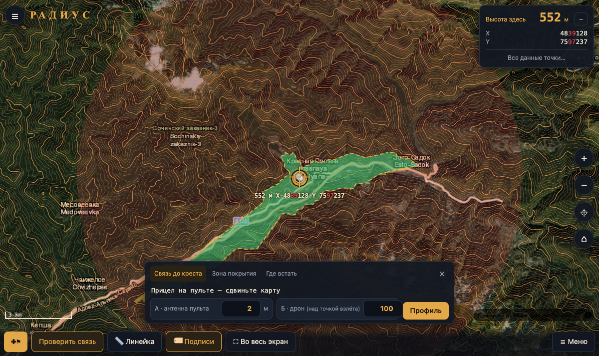

# uavmap

Гражданская карта радиовидимости для пилотов дронов: насколько далеко можно улететь с учётом рельефа, на каких частотах и на какой высоте связь будет держаться.

> **Статус: MVP.** Связь до прицела, профиль трассы, зона покрытия по высотам, подбор места пилота, метки, маршруты, импорт и экспорт. Расчёт покрыт тестами (`npm run check`).



## Что умеет (и будет уметь)

- **Связь до прицела.** Ставите пульт («Пульт здесь» или по GPS), двигаете карту — строка связи внизу говорит одной фразой, держится ли связь, и что делать с высотой («Поднимите до 480 м — будет и видео»); мелко — запас в дБ и азимут. Под прицелом — насколько место выше или ниже пульта.
- **Высотомер.** Вертикальная шкала высоты дрона над пультом: цветом показано, на какой высоте связь есть, на грани или нет, внизу — склон, если цель выше пульта. Дрон перетаскивается пальцем, строка связи отвечает сразу; нажатие на число — точная высота.
- **Интерфейс:** нижняя панель «Метка · Зона · Где встать · Меню», одна общая высота дрона (высотомер), высота антенны пульта — в его карточке, темы День / Ночь / Авто, шрифты Golos Text и JetBrains Mono для яркого солнца; линейка и маршруты — в «Меню → Инструменты».
- **Две радиолинии:** управление и видео считаются одновременно (у видео свои частота и аппаратура); статус, профиль, зона покрытия и «Где встать» — по худшей линии, мин. высота — чтобы держались обе.
- **Профиль трассы:** рельеф с учётом кривизны Земли, линия визирования, первая зона Френеля и её 60 %, препятствия.
- **Сравнение высот и аппаратуры:** запас связи на разных высотах дрона и для разных пресетов (ELRS 2.4 ГГц / 868 МГц, Crossfire, LoRa 433, видео 5.8 / 1.2 ГГц и др.), минимальная высота для связи.
- **Зона покрытия:** карта связи вокруг пульта для текущей высоты дрона; в «Ещё» — сравнение нескольких высот и карта нужной высоты полёта. После расчёта на карте остаётся компактная плашка.
- **Где встать пилоту:** сразу ищет в радиусе 1 км (при неудаче — 3 км) точку, откуда связь с прицелом лучше.
- **Режимы высоты:** над точкой взлёта (как в полётных контроллерах) или над рельефом.
- Карта: спутник, топо, схема, подписи и дороги, горизонтали с отметками высот, отмывка рельефа. Координаты WGS-84 и СК-42 (Гаусс–Крюгер).
- Метки, маршруты, линейка, импорт и экспорт GeoJSON / GPX / KML. Все данные хранятся только на устройстве.
- **Офлайн:** приложение устанавливается на телефон (PWA) и открывается без сети; рельеф района (5–40 км) скачивается заранее — профиль, зона и горизонтали считаются офлайн.
- **Свои карты:** офлайн-подложки из PMTiles (из MBTiles — `pmtiles convert`) и свой рельеф из SRTM HGT; файлы хранятся в браузере (OPFS).
- **Мобильная версия:** крупные кнопки, шторка снизу со свайпом, долгое нажатие на карту — данные точки.

## Модель расчёта

- Потери в свободном пространстве: `FSPL = 32.45 + 20·lg(d, км) + 20·lg(f, МГц)`.
- Дифракция на рельефе — **дельта-Буллингтон по ITU-R P.526-15 §4.5** (как в P.1812/P.452): Буллингтон по реальному профилю + дифракция над сферической Землёй (§3.2). Одинаково в профиле и в зоне покрытия.
- Рельеф: максимум высот в окне вокруг каждого отсчёта (вершины хребтов не сглаживаются), единые шаг и детализация для профиля и зоны.
- Местность у пульта (открыто / редкие деревья / посёлок / лес): поправка по ITU-R P.833 и P.2108, зависит от частоты.
- Эквивалентный радиус Земли `k·R`, по умолчанию `k = 4/3`.
- Запас = `Pпрд + Gпрд + Gпрм − потери − FSPL − дифракция − чувствительность`.

Помехи, отражения и диаграммы направленности антенн не моделируются; для особых случаев есть ручные «потери на местности». Значения пресетов ориентировочные, подставьте паспортные данные своей аппаратуры. Результат — оценка для планирования, а не гарантия связи.

## Запуск

```bash
npm install
npm run dev -- --port 5174   # http://localhost:5174
npm run check    # типы + линтер + тесты
npm run build    # сборка для GitHub Pages (base /uavmap/)
node scripts/smoke.mjs http://localhost:5174/   # дымовой тест в headless Chrome
```

## Данные

- Рельеф: [Mapzen Terrain Tiles](https://registry.opendata.aws/terrain-tiles/) (AWS Open Data; SRTM, GMTED, ETOPO1 и др.).
- Подложки: Esri World Imagery, OpenTopoMap (CC-BY-SA), OpenStreetMap. Соблюдайте условия использования провайдеров тайлов.

## Стек

TypeScript, Vite, MapLibre GL JS, PMTiles, maplibre-contour. Пересчёт WGS-84 ↔ СК-42 — свой (Гаусс–Крюгер, ряды Крюгера n⁶, 7 параметров ГОСТ 32453), сверен с proj4 в тестах. Работает и в старом Chrome 68 (Android-пульты без Google Play).

## Лицензия

[MIT](LICENSE)
